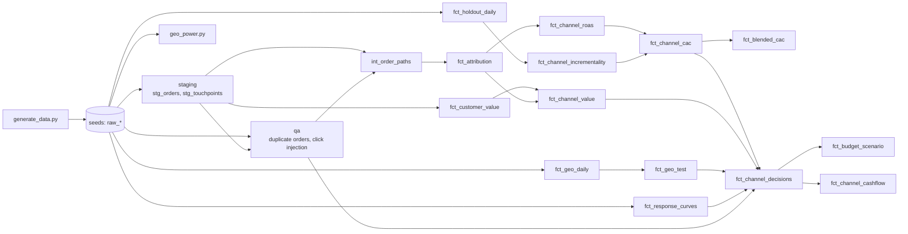

# marketing-measurement-lab

One decision per marketing channel, **scale, test or stop**, and the tested data behind it. Attribution, holdout tests, response curves, customer value, payback and tracking QA all feed that one decision, against the goals of an imaginary online shop: pay back customer acquisition within 180 days and bring blended CAC under EUR 26.

Runs on your laptop with DuckDB: no account, no cloud, no cost. All data is synthetic and seeded: there is no real company, customer or ad account behind any number here.

**Start here**
- [Decision memo](docs/decision_memo.md): the decisions and what they do to the goals, for the people who decide on budget.
- [Methodology](docs/methodology.md): why each method was chosen, what else was considered, how much each choice moves the numbers, and which decisions survive other assumptions.
- [Recreate it](#recreate-it): from a fresh clone to every table and chart in about five minutes.

## The decisions


| Channel | Decision | Incremental CAC | ROI, worst / expected / best | Next euro (marginal ROI) | Profitable spend | Payback | Why |
|---|---|---:|---|---:|---:|---:|---|
| paid_social | **SCALE** | EUR 36.06 | 1.39 / 1.68 / 1.83 | 1.14 | 1.48x today | by day 30 | The next euro still pays back, and so does the worst case |
| display | **TEST** | EUR 41.01 | 0.92 / 1.29 / 1.68 | 0.74 | 0.49x today | by day 90 | Pays back on average, but its last euros do not: test a lower budget |
| affiliate | **TEST** | EUR 58.29 | 0.00 / 0.85 / 3.27 | n/a | n/a | none | Could be a winning or a losing channel; 48 injected clicks found |
| paid_search | **STOP** | EUR 147.21 | 0.29 / 0.38 / 0.48 | 0.11 | n/a | none | Does not pay back even in the best case |
| regional_campaign | **STOP** | EUR 113.24 | 0.27 / 0.50 / 0.73 | n/a | n/a | none | Works (+8% conversions) but does not pay back |

ROI here is the 180-day gross profit of the customers a channel **added** (not the ones it claimed), per euro it cost. At 1.0 the channel has paid for itself within the horizon. Average ROI says whether a channel is worth having; marginal ROI, from its response curve, says whether the *next* euro is. The rule only speaks when the data allows it:

- **SCALE**: the next euro still pays back (marginal ROI at least 1.0), and the average pays back even at the pessimistic end of the incrementality interval.
- **STOP**: ROI below 1.0 even at the optimistic end.
- **TEST**: everything else. The data cannot yet back a scale or a stop, so the next step is a sharper test.

**What the decisions do to the goals.** Stopping paid search frees EUR 14,127 and loses only the 96 customers it actually added. Paid social takes as much of it as still pays back: its response curve says the next euro stops paying back at 1.48 times today's spend, so it gets EUR 7,137. The other EUR 6,990 is not spent, because spending it would lower profit.

| Plan | Cost | Customers | Blended CAC | 180-day gross profit | Profit after marketing | Goal: CAC under EUR 26 |
|---|---:|---:|---:|---:|---:|---|
| Current | EUR 37,464 | 1,339 | EUR 27.98 | EUR 76,353 | EUR 38,889 | missed |
| After decisions | EUR 30,475 | 1,368 | EUR 22.27 | EUR 78,544 | EUR 48,070 | met |

19% less budget, 2% more customers, and 24% more profit after marketing. The regional campaign is a separate budget: stopping it saves EUR 81,984 per 28-day run, for which it buys about EUR 41,000 of 180-day gross profit.

`fct_channel_decisions` and `fct_budget_scenario` hold these tables; `python scripts/report.py` prints them.

## The evidence behind each decision



### 1. Who took part: attribution

Same orders, two attribution models:

| Channel | ROAS, last click | ROAS, position-based |
|---|---:|---:|
| paid_social | 1.48 | 1.83 |
| display | 1.92 | 2.35 |
| paid_search | 1.41 | 1.07 |

Journeys tend to start on social and display and end on search. Last click hands search the credit for demand that other channels created. Under position-based attribution (40% first touch, 40% last, 20% shared by the middle) search drops close to break-even.

Orders with no tracked touchpoint (60 orders, EUR 3,621) stay in the table as `unattributed`, so the channels always add up to total revenue. Affiliate cost is the 10% commission the network invoices on the orders it claims by last click, so affiliate ROAS is exactly 10 under last click and 9.04 under position-based. A high, fixed ROAS says nothing about whether affiliates bring new customers.

### 2. Who made the difference: holdout tests

Attribution cannot tell whether a channel adds customers or claims ones who would have come anyway. A holdout test can: switch the channel off in half of the regions for 28 days and measure how much *total* conversions drop. Whatever the channel claimed beyond that drop would have arrived anyway, as organic or unattributed. The generator ran one holdout per paid channel in 2025, with a planted true incrementality:

| Channel | Planted | Measured | 95% interval | Verdict |
|---|---:|---:|---:|---|
| paid_social | 0.85 | 0.92 | 0.76 to 1.08 | mostly incremental |
| display | 0.60 | 0.64 | 0.45 to 0.83 | inconclusive |
| paid_search | 0.45 | 0.38 | 0.29 to 0.48 | mostly claims existing demand |
| affiliate | 0.15 | 0.11 | -0.20 to 0.43 | mostly claims existing demand |

Incrementality 0.38 means: of every 100 customers paid search claims, about 38 would not have come without it; the other 62 would have found the shop anyway.

### 3. What a customer costs: CAC, three ways

| Channel | CAC, last click | CAC, position-based | CAC, incremental |
|---|---:|---:|---:|
| paid_social | EUR 41.65 | EUR 33.10 | EUR 36.06 |
| display | EUR 31.55 | EUR 26.17 | EUR 41.01 |
| paid_search | EUR 42.04 | EUR 56.09 | EUR 147.21 |
| affiliate | EUR 5.92 | EUR 6.53 | EUR 58.29 |

Blended CAC, the number finance sees, next to the views that explain it:

| View | Cost | Customers | CAC |
|---|---:|---:|---:|
| Blended: all cost / all customers | EUR 37,464 | 1,339 | EUR 27.98 |
| Paid media only (search, social, display) | EUR 36,789 | 999 | EUR 36.83 |
| Blended without affiliate, as attributed | EUR 36,789 | 1,236 | EUR 29.77 |
| Blended without affiliate, incremental | EUR 36,789 | 1,327 | EUR 27.71 |
| Incremental: paid media and affiliate cost / customers they added | EUR 37,464 | 710 | EUR 52.78 |

Affiliates look like the cheapest channel and on paper pull blended CAC down from EUR 29.77 to EUR 27.98. But only about 12 of their 103 customers are incremental. Without affiliates the business saves EUR 675 in commission, loses about 12 customers, and blended CAC drops to EUR 27.71.

### 4. How far to scale: response curves

A channel that pays back on average can still waste its last euros. To see how the customers a channel adds grow with spend, each paid channel ran an 8-week budget-step test: every week, each of the 16 regions got a random spend level, from switched off to 3 times today. Regions with the channel off give the baseline; the rest show the added customers at each level. A curve `added = today x spend ^ elasticity` fits them; elasticity below 1 means each extra euro buys fewer customers than the last.

| Channel | Planted elasticity | Measured | 95% interval |
|---|---:|---:|---:|
| paid_social | 0.70 | 0.68 | 0.40 to 0.96 |
| display | 0.60 | 0.57 | 0.12 to 1.02 |
| paid_search | 0.40 | 0.28 | 0.01 to 0.56 |

On this curve the next euro earns elasticity x average ROI, which gives each channel's marginal ROI and the spend at which the next euro stops paying back:


Paid social can grow to about 1.5 times today's spend. Display is already beyond its profitable level: its average ROI of 1.29 hides last euros that earn only 0.74. Paid search is far past it at any spend.

The elasticity intervals are wide: six spend levels are few points for a curve. For paid social, the profitable spend lies anywhere between 0.5 and 3 times today across its interval. That is why the plan grows social in steps and re-measures.

### 5. What a customer is worth: value and payback

Customers come back. Gross profit per customer (50% margin), cumulative by day since the first order, weighted by position-based credit:

| Channel | First order | Day 90 | Day 180 |
|---|---:|---:|---:|
| email | EUR 30.43 | EUR 48.61 | EUR 61.66 |
| paid_social | EUR 30.36 | EUR 46.92 | EUR 60.55 |
| paid_search | EUR 30.04 | EUR 44.96 | EUR 56.09 |
| display | EUR 30.70 | EUR 42.66 | EUR 53.08 |
| affiliate | EUR 29.49 | EUR 40.88 | EUR 49.58 |

First orders are worth the same everywhere; the difference is who comes back. Affiliate customers (often coupon hunters) return least.

The cash view puts value and cost together: net cash per EUR 1,000 spent, by day since acquisition, counting only the customers each channel added. Day 0 pays the full spend; repeat orders pay it back.

| Channel | Day 0 | Day 30 | Day 90 | Day 180 |
|---|---:|---:|---:|---:|
| paid_social | -158 | +22 | +301 | +679 |
| display | -252 | -151 | +40 | +294 |
| affiliate | -493 | -434 | -297 | -148 |
| regional_campaign | -733 | -686 | -602 | -496 |
| paid_search | -796 | -763 | -694 | -619 |

Paid social is back in the black within a month, so scaling it ties up little cash. Display needs three months. Of every EUR 1,000 in paid search, EUR 619 is still lost after six months.

### 6. Is the data telling the truth: tracking QA

| Check | What it finds | In this data | Effect on the decision |
|---|---|---|---|
| `qa_duplicate_orders` | Purchase tag firing twice | 29 orders, EUR 1,806 revenue overstated (2.2%) | Removed before any ROAS, CAC or value is computed |
| `qa_click_injection` | Affiliate clicks logged 2 to 8 seconds before checkout | 48 clicks, EUR 2,912 of orders | Excluded from attribution; listed on the affiliate decision for a commission dispute |

### 7. Did the campaign cause it: geo test

A campaign ran for 28 days in 6 of Germany's 16 states (Bayern, Berlin, Bremen, Mecklenburg-Vorpommern, Saarland, Sachsen); the other 10 states are the control. The generator planted a true lift of 8%.


| Readout | Estimate | 95% interval |
|---|---:|---:|
| Lift in conversions | +8.1% | +4.2% to +12.1% |
| Incremental conversions | 724 | 390 to 1,047 |
| Cost per incremental conversion (EUR 81,984 spend) | EUR 113 | EUR 78 to EUR 210 |

`fct_geo_test` runs a difference-in-differences on the daily log ratio between treatment and control, each indexed to its own 56 days before the campaign, so the shared weekend dip and trend cancel out. The campaign works; at EUR 113 per extra customer against EUR 57 of 180-day gross profit, it does not pay.

**How big must a test be?** `scripts/geo_power.py` answers that before any money is spent. It takes only the days before the campaign, picks 500 random sets of 6 treatment regions, adds a known lift and runs the same estimator. Each simulated test uses 28 days of history, because the fake test window has to fit inside the 56 days before the campaign; the real readout uses all 56, so it is slightly more precise than this table:

| True lift | 14 days | 28 days |
|---|---:|---:|
| 0% (false alarms) | 5% | 6% |
| 4% | 34% | 53% |
| 6% | 60% | 77% |
| 8% | 82% | 93% |
| 10% | 93% | 99% |

With 6 regions, a 28-day test finds a 7% lift 80% of the time; a 14-day test needs 8%. The TEST decisions above need this kind of sizing before they start.

## How it is checked

`dbt build` runs 22 models and 50 tests. Besides the usual `unique` / `not_null` / `accepted_values` tests, twelve tests guard the logic itself:

- `assert_weights_sum_to_one`: every order hands out exactly 100% credit under each model.
- `assert_revenue_reconciles`: attributed revenue equals the revenue of every order, `unattributed` included.
- `assert_incrementality_recovers_planted`: each holdout readout's interval contains the incrementality the generator planted.
- `assert_curves_recover_planted`: each fitted elasticity interval contains the elasticity the generator planted.
- `assert_cac_reconciles`: blended CAC rests on every customer and every euro of cost, the affiliate commission recomputed independently.
- `assert_value_reconciles`: total customer value equals margin times all first and repeat orders within the horizon, recomputed from the sources.
- `assert_value_never_decreases`: cumulative gross profit only grows with time.
- `assert_every_paid_channel_decided`: every channel that costs money gets a decision, and every decision a cash line.
- `assert_cashflow_matches_roi`: the cash line ends where the ROI says (net cash at the horizon = 1,000 x (ROI - 1)).
- `assert_scenario_budget_neutral`: the new budget equals the old one minus what STOP channels freed plus what SCALE channels may take up to their profitable spend, recomputed independently.
- `assert_geo_test_recovers_planted_lift`: the geo readout's interval contains the lift the generator planted.
- `assert_geo_placebo_shows_no_effect`: the same estimator on the two halves of the pre-campaign period finds nothing.

A test only counts once it has been seen failing, so each one was run against a deliberately broken version:

- First-touch weight 0.45 instead of 0.4: 850 orders fail the weights test, and the revenue reconciliation fails.
- An inner join instead of a left join in `int_order_paths` (unattributed orders dropped): the revenue reconciliation fails.
- Removing the deduplication makes `unique_stg_orders_order_id` fail on 29 orders.
- Treating every attributed conversion as incremental (what attribution implicitly does) makes the incrementality test fail for all 4 channels.
- Dropping the affiliate commission from cost makes the CAC reconciliation fail.
- Dropping the `coalesce` for customers without repeat orders makes the value reconciliation fail; counting only same-day repeat orders fails both value tests.
- Reading every cash day from the first order only fails the cash test for all 5 decided channels.
- Dropping display from the decision model fails the every-channel test; allocating the freed budget with the wrong denominator fails the budget test.
- Fitting the curves on raw conversions, without subtracting the switched-off regions' baseline, fails the elasticity test for all 3 channels.
- Dropping the profitable-spend cap from the plan (moving all freed budget to social) fails the budget test.
- Swapping treatment and control fails the planted-lift test; letting the placebo read into the campaign period fails the placebo test.
- `geo_power.py` checks itself: with the interval removed (z = 0) its false-alarm check fails.

Two tests could not fail in their first version, and the deliberate break is what showed it: the CAC reconciliation read the commission from the model it was checking, and the budget plan copied its total cost instead of adding up what it moved. Both now recompute what they check.

GitHub Actions runs the generator, the power check, the full build and the report on every push.

## Recreate it

You need Python 3.10 or newer and git. Nothing else: no database server, no cloud account.

**1. Get the code and install dbt** (one time, about a minute):

```bash
git clone https://github.com/predkiewicz/marketing-measurement-lab.git
cd marketing-measurement-lab
python -m venv .venv
source .venv/bin/activate        # Windows: .venv\Scripts\activate
pip install -r requirements.txt
```

**2. Generate the data.** Same seed, same data, so your numbers match the ones on this page:

```bash
python scripts/generate_data.py  # writes seeds/*.csv
```

**3. Build and test everything.** Loads the data into `target/lab.duckdb`, runs all models and all tests:

```bash
dbt build --profiles-dir .       # ends with: Done. PASS=... ERROR=0
```

**4. Read the results.** Prints the decisions, the budget plan and every table behind them, and redraws the charts in `docs/`:

```bash
python scripts/report.py
python scripts/geo_power.py      # power table for the geo test
```

**5. Change an assumption and see which decisions move.** Goals, margin and every rule threshold are dbt variables in `dbt_project.yml`:

```bash
dbt build --profiles-dir . --vars '{gross_margin: 0.4}'   # thinner margin: paid social drops from SCALE to TEST
python scripts/report.py
```

**6. Break a test on purpose.** In `models/marts/fct_attribution.sql`, change `then 0.4` to `then 0.45` and run `dbt build --profiles-dir .` again: `assert_weights_sum_to_one` fails. Change it back.

Different data: `python scripts/generate_data.py --users 20000 --seed 1`, then steps 3 and 4.

## Layout

```
scripts/generate_data.py   synthetic touchpoints, orders, repeat orders, ad spend, holdout, budget-step and geo tests (stdlib only)
scripts/geo_power.py       simulation-based power for the geo test (stdlib only)
scripts/report.py          prints every result table, draws the three charts in docs/
docs/                      decision memo, methodology, charts
models/staging/            cleaned sources, duplicates removed
models/qa/                 tracking checks: duplicate orders, click injection
models/marts/              attribution, ROAS, CAC, incrementality, response curves, customer value, geo test, decisions, budget plan
tests/                     logic tests that must fail when the logic breaks
```

Settings live in `dbt_project.yml` vars. Goals and decision rules: gross margin (50%), value horizon and payback goal (180 days), blended CAC goal (EUR 26), stop threshold (ROI 1.0), highest spend level the curves may plan for (3x today). Measurement: lookback window (30 days), click-injection threshold (10 seconds), affiliate fee (10%), incrementality verdict line (0.5), geo test start (1 June 2026) and interval (95%).

## Roadmap

- [x] Incrementality-calibrated CAC: holdout tests per paid channel, CAC reported vs incremental
- [x] Customer value and payback: repeat purchases by acquisition channel, 180-day gross profit, payback day
- [x] Decisions per channel and the budget plan they imply
- [x] Response curves from budget-step tests: marginal ROI and profitable spend per channel
- [ ] Optimal allocation across several SCALE channels (equal marginal ROI) instead of a split by today's cost
- [x] Cash view per channel: net cash per EUR 1,000 by day since acquisition
- [ ] Consent-aware counts: simulate consent opt-outs that differ by device and channel, show how they distort ROAS, and how modelled conversions fill the gap
- [ ] Stronger geo inference: autocorrelated and uneven regional data, where the simple interval becomes too narrow; fix with permutation inference or time-based regression
- [ ] Agent skills that work on this repo: a Tag Manager container audit (consent settings, duplicate pixels, dead triggers), a tracking-plan writer, a metric-definition review; each with its own test cases

## Working with AI agents

The repo is set up for coding agents (Claude Code, Gemini, Codex). `AGENTS.md` holds the rules and `CLAUDE.md` imports it, so there is one source and nothing to drift. The main rule is the one above: no change is done until `dbt build` is green, and a new test is not trusted until it has been seen failing.

## Author

Piotr Prędkiewicz, marketing and product analytics, Berlin. [predkiewicz.com](https://www.predkiewicz.com) · [LinkedIn](https://www.linkedin.com/in/predkiewicz)

MIT licence.
