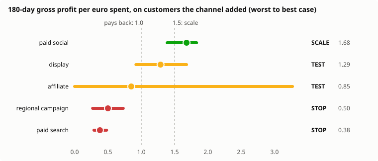
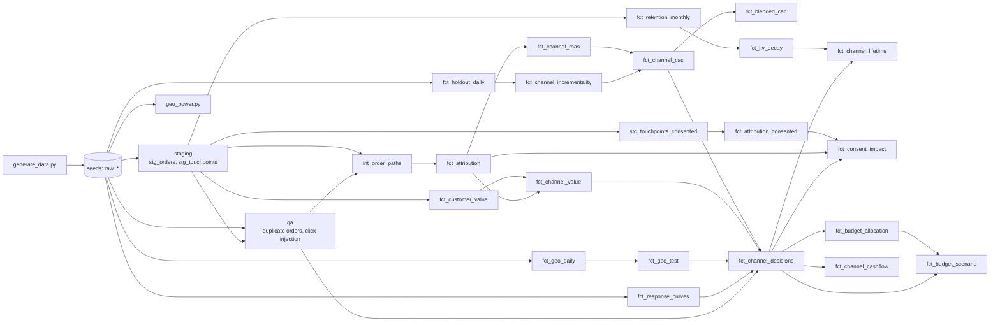
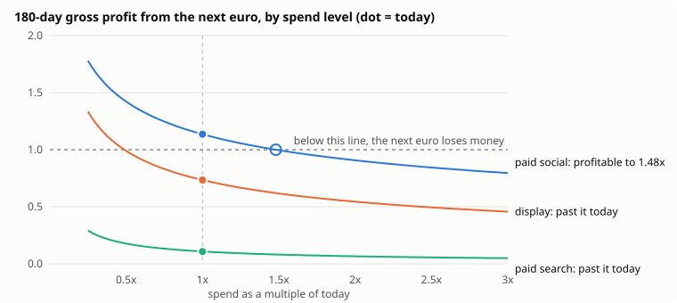
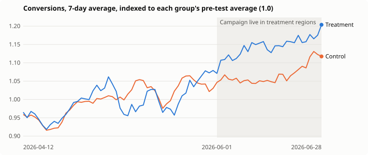

# marketing-measurement-lab

One decision per marketing channel, **scale, test or stop**, and the tested data behind it. Attribution, holdout tests, response curves, customer value, payback, consent modelling and tracking QA all feed that one decision, against the goals of an imaginary online shop: pay back customer acquisition within 180 days and bring blended CAC under EUR 26.

Runs on your laptop with DuckDB: no account, no cloud, no cost. All data is synthetic and seeded: there is no real company, customer or ad account behind any number here.

**Start here**
- [Decision memo](docs/decision_memo.md): the decisions and what they do to the goals, for the people who decide on budget.
- [Methodology](docs/methodology.md): why each method was chosen, what else was considered, how much each choice moves the numbers, and which decisions survive other assumptions.
- [Which analysis for which decision](docs/decision_guide.md): not every decision needs every model. A table of decisions (daily optimisation, finance checks, cash flow, budget shifts, planning, business cases, test / scale / stop) and the calculations each one needs, can skip, and costs.
- [Recreate it](#recreate-it): from a fresh clone to every table and chart in about five minutes.

**Not every decision needs every model.** This lab runs all of them because it is built to show and test each one. Daily optimisation inside a channel runs on clean tracking and platform trends; finance checks on blended CAC and reconciled numbers; only budget shifts, scaling and business cases need holdouts, response curves or geo tests. The [decision guide](docs/decision_guide.md) maps each decision to the calculations it needs.

## The decisions



| Channel | Decision | Incremental CAC | ROI, worst / expected / best | Next euro (marginal ROI) | Profitable spend | Payback | Why |
|---|---|---:|---|---:|---:|---:|---|
| paid_social | **SCALE** | EUR 36.06 | 1.39 / 1.68 / 1.83 | 1.14 | 1.48x today | by day 30 | The next euro still pays back, and so does the worst case |
| display | **TEST** | EUR 41.01 | 0.92 / 1.29 / 1.68 | 0.74 | 0.49x today | by day 90 | Pays back on average, but its last euros do not: test a lower budget |
| affiliate | **TEST** | EUR 58.29 | 0.00 / 0.85 / 3.27 | n/a | n/a | none | Could be a winning or a losing channel; 48 injected clicks found |
| paid_search | **STOP** | EUR 147.21 | 0.29 / 0.38 / 0.48 | 0.11 | n/a | none | Does not pay back even in the best case |
| regional_campaign | **STOP** | EUR 112.93 | 0.12 / 0.50 / 0.86 | n/a | n/a | none | Works (+8% conversions) but does not pay back |

ROI here is the 180-day gross profit of the customers a channel **added** (not the ones it claimed), per euro it cost. At 1.0 the channel has paid for itself within the horizon. Average ROI says whether a channel is worth having; marginal ROI, from its response curve, says whether the *next* euro is. The rule only speaks when the data allows it:

- **SCALE**: the next euro still pays back (marginal ROI at least 1.0), and the average pays back even at the pessimistic end of the incrementality interval.
- **STOP**: ROI below 1.0 even at the optimistic end.
- **TEST**: everything else. The data cannot yet back a scale or a stop, so the next step is a sharper test.

**What the decisions do to the goals.** Stopping paid search frees EUR 14,127 and loses only the 96 customers it actually added. The freed money goes to the SCALE channels so that the next euro earns the same everywhere (equal marginal ROI), and no channel beyond the spend where its next euro stops paying back. Here paid social is the only SCALE channel: its response curve caps it at 1.48 times today's spend, so it gets EUR 7,137. The other EUR 6,990 is not spent, because spending it would lower profit.

| Plan | Cost | Customers | Blended CAC | 180-day gross profit | Profit after marketing | Goal: CAC under EUR 26 |
|---|---:|---:|---:|---:|---:|---|
| Current | EUR 37,464 | 1,339 | EUR 27.98 | EUR 76,353 | EUR 38,889 | missed |
| After decisions | EUR 30,475 | 1,368 | EUR 22.27 | EUR 78,544 | EUR 48,070 | met |

19% less budget, 2% more customers, and 24% more profit after marketing. The regional campaign is a separate budget: stopping it saves EUR 81,984 per 28-day run, for which it buys about EUR 41,000 of 180-day gross profit.

`fct_channel_decisions` and `fct_budget_scenario` hold these tables; `python scripts/report.py` prints them.

## The evidence behind each decision



### 1. Who took part: attribution

Same orders, two attribution models:

| Channel | ROAS, last click | ROAS, position-based |
|---|---:|---:|
| paid_social | 1.48 | 1.83 |
| display | 1.92 | 2.35 |
| paid_search | 1.41 | 1.07 |

Journeys tend to start on social and display and end on search. Last click hands search the credit for demand that other channels created. Under position-based attribution (40% first touch, 40% last, 20% shared by the middle) search drops close to break-even.

Orders with no tracked touchpoint (60 orders, EUR 3,621) stay in the table as `unattributed`, so the channels always add up to total revenue. Affiliate cost is the 10% commission the network invoices on the orders it claims by last click, so affiliate ROAS is exactly 10 under last click and 9.04 under position-based. A high, fixed ROAS says nothing about whether affiliates bring new customers.

### 2. Who made the difference: holdout tests

Attribution cannot tell whether a channel adds customers or claims ones who would have come anyway. A holdout test can: switch the channel off in half of the regions for 28 days and measure how much *total* conversions drop. Whatever the channel claimed beyond that drop would have arrived anyway, as organic or unattributed. The generator ran one holdout per paid channel in 2025, with a planted true incrementality:

| Channel | Planted | Measured | 95% interval | Verdict |
|---|---:|---:|---:|---|
| paid_social | 0.85 | 0.92 | 0.76 to 1.08 | mostly incremental |
| display | 0.60 | 0.64 | 0.45 to 0.83 | inconclusive |
| paid_search | 0.45 | 0.38 | 0.29 to 0.48 | mostly claims existing demand |
| affiliate | 0.15 | 0.11 | -0.20 to 0.43 | mostly claims existing demand |

Incrementality 0.38 means: of every 100 customers paid search claims, about 38 would not have come without it; the other 62 would have found the shop anyway.

### 3. What a customer costs: CAC, three ways

| Channel | CAC, last click | CAC, position-based | CAC, incremental |
|---|---:|---:|---:|
| paid_social | EUR 41.65 | EUR 33.10 | EUR 36.06 |
| display | EUR 31.55 | EUR 26.17 | EUR 41.01 |
| paid_search | EUR 42.04 | EUR 56.09 | EUR 147.21 |
| affiliate | EUR 5.92 | EUR 6.53 | EUR 58.29 |

Blended CAC, the number finance sees, next to the views that explain it:

| View | Cost | Customers | CAC |
|---|---:|---:|---:|
| Blended: all cost / all customers | EUR 37,464 | 1,339 | EUR 27.98 |
| Paid media only (search, social, display) | EUR 36,789 | 999 | EUR 36.83 |
| Blended without affiliate, as attributed | EUR 36,789 | 1,236 | EUR 29.77 |
| Blended without affiliate, incremental | EUR 36,789 | 1,327 | EUR 27.71 |
| Incremental: paid media and affiliate cost / customers they added | EUR 37,464 | 710 | EUR 52.78 |

Affiliates look like the cheapest channel and on paper pull blended CAC down from EUR 29.77 to EUR 27.98. But only about 12 of their 103 customers are incremental. Without affiliates the business saves EUR 675 in commission, loses about 12 customers, and blended CAC drops to EUR 27.71.

### 4. How far to scale: response curves

A channel that pays back on average can still waste its last euros. To see how the customers a channel adds grow with spend, each paid channel ran an 8-week budget-step test: every week, each of the 16 regions got a random spend level, from switched off to 3 times today. Regions with the channel off give the baseline; the rest show the added customers at each level. A curve `added = today x spend ^ elasticity` fits them; elasticity below 1 means each extra euro buys fewer customers than the last.

| Channel | Planted elasticity | Measured | 95% interval |
|---|---:|---:|---:|
| paid_social | 0.70 | 0.68 | 0.40 to 0.96 |
| display | 0.60 | 0.57 | 0.12 to 1.02 |
| paid_search | 0.40 | 0.28 | 0.01 to 0.56 |

On this curve the next euro earns elasticity x average ROI, which gives each channel's marginal ROI and the spend at which the next euro stops paying back:



Paid social can grow to about 1.5 times today's spend. Display is already beyond its profitable level: its average ROI of 1.29 hides last euros that earn only 0.74. Paid search is far past it at any spend.

The elasticity intervals are wide: six spend levels are few points for a curve. For paid social, the profitable spend lies anywhere between 0.5 and 3 times today across its interval. That is why the plan grows social in steps and re-measures.

### 5. What a customer is worth: value and payback

Customers come back. Gross profit per customer (50% margin), cumulative by day since the first order, weighted by position-based credit:

| Channel | First order | Day 90 | Day 180 |
|---|---:|---:|---:|
| email | EUR 30.43 | EUR 48.61 | EUR 61.66 |
| paid_social | EUR 30.36 | EUR 46.92 | EUR 60.55 |
| paid_search | EUR 30.04 | EUR 44.96 | EUR 56.09 |
| display | EUR 30.70 | EUR 42.66 | EUR 53.08 |
| affiliate | EUR 29.49 | EUR 40.88 | EUR 49.58 |

First orders are worth the same everywhere; the difference is who comes back. Affiliate customers (often coupon hunters) return least.

The cash view puts value and cost together: net cash per EUR 1,000 spent, by day since acquisition, counting only the customers each channel added. Day 0 pays the full spend; repeat orders pay it back.

| Channel | Day 0 | Day 30 | Day 90 | Day 180 |
|---|---:|---:|---:|---:|
| paid_social | -158 | +22 | +301 | +679 |
| display | -252 | -151 | +40 | +294 |
| affiliate | -493 | -434 | -297 | -148 |
| regional_campaign | -732 | -685 | -601 | -495 |
| paid_search | -796 | -763 | -694 | -619 |

Paid social is back in the black within a month, so scaling it ties up little cash. Display needs three months. Of every EUR 1,000 in paid search, EUR 619 is still lost after six months.

**Beyond 180 days: lifetime value.** Customers keep buying after six months, less and less. Each month, only customers observed that long count (the analysis date is 27 November 2026, so the January cohort has 10 months of history, March 8). After month 6, repeat buying fades by a shared 18% per month (decay 0.82, interval 0.74 to 0.91; planted: 0.85). Projected to 36 months and discounted at 10% a year:

| Channel | Gross profit, 180 days | Lifetime value (interval) | ROI, 180 days | ROI, lifetime | Paid back in month |
|---|---:|---:|---:|---:|---:|
| paid_social | EUR 60.55 | EUR 81 (74 to 102) | 1.68 | 2.25 | 1 |
| display | EUR 53.08 | EUR 68 (63 to 84) | 1.29 | 1.66 | 3 |
| affiliate | EUR 49.58 | EUR 63 (58 to 77) | 0.85 | 1.09 | 11 |
| regional_campaign | EUR 57.02 | EUR 75 (69 to 94) | 0.50 | 0.66 | never |
| paid_search | EUR 56.09 | EUR 74 (67 to 92) | 0.38 | 0.50 | never |

The decisions stay on the 180-day goal, because that is cash the business has, while the lifetime value is a projection. The lifetime view changes none of them: paid search and the regional campaign do not pay back even over three years. Affiliate is where the two views part: over a lifetime it might pay back (in month 11, on an incrementality estimate that is itself uncertain), within the cash goal it does not. That is one more reason its decision is TEST, not STOP.

### 6. Is the data telling the truth: tracking QA

| Check | What it finds | In this data | Effect on the decision |
|---|---|---|---|
| `qa_duplicate_orders` | Purchase tag firing twice | 29 orders, EUR 1,806 revenue overstated (2.2%) | Removed before any ROAS, CAC or value is computed |
| `qa_click_injection` | Affiliate clicks logged 2 to 8 seconds before checkout | 48 clicks, EUR 2,912 of orders | Excluded from attribution; listed on the affiliate decision for a commission dispute |

### 7. What tracking cannot see: consent

Users who decline the consent banner are invisible to tracking, but their orders still reach the shop's backend, where they look like `unattributed`. Consent rates differ by device (iOS lowest), and device mix differs by channel: paid social traffic is mostly iOS. So the loss is uneven, and it hits the channel that matters most. The generator plants this; the banner logs only aggregate counts per landing channel and device.

`fct_consent_impact` compares three views of the same orders: the truth (full journeys, which only a simulation has), what a consent-only setup reports, and a model that weights each observed order by 1 / consent rate of the channel its journey started from:

| Channel | Consent rate | Customers: true / observed / modelled | CAC: true / observed / modelled | Decision: true / observed / modelled |
|---|---:|---|---|---|
| paid_social | 49% | 449 / 250 (-44%) / 478 (+7%) | EUR 33 / 60 / 31 | SCALE / **TEST** / SCALE |
| display | 64% | 298 / 193 (-35%) / 311 (+4%) | EUR 26 / 40 / 25 | TEST / TEST / TEST |
| paid_search | 68% | 252 / 159 (-37%) / 261 (+4%) | EUR 56 / 89 / 54 | STOP / STOP / STOP |
| affiliate | 67% | 103 / 68 (-34%) / 109 (+5%) | EUR 7 / 10 / 6 | TEST / TEST / TEST |

On consent-only data, paid social loses 44% of its customers, its CAC nearly doubles, and its decision drops from SCALE to TEST: the business would stop growing its best channel. Modelling brings every channel back within 7% and restores every decision.

The holdout, budget-step and geo tests count backend orders, so consent does not touch them; that is one more reason to decide on experiments, not on tracked attribution alone. The weak spot of the model is the leftover: every channel's small over-count lands in `unattributed`, so modelled direct orders shrink from 60 to 6. Direct traffic is the least reliable number in a consent-modelled report.

### 8. Did the campaign cause it: geo test

A campaign ran for 28 days in 6 of Germany's 16 states (Bayern, Berlin, Bremen, Mecklenburg-Vorpommern, Saarland, Sachsen); the other 10 states are the control. The generator planted a true lift of 8%. Like real regional data, each state drifts: a deviation today (local weather, an event, a stock-out) carries over into the next days, and each state has its own slow trend.



`fct_geo_test` runs a difference-in-differences on the daily log ratio between treatment and control, each indexed to its own 56 days before the campaign, so the shared weekend dip and trend cancel out. The question is how wide the interval around it has to be.

**The textbook standard error is too narrow here.** It treats every day as an independent draw. With drift, consecutive days repeat each other, so 28 days hold less information than they seem to. `fct_geo_placebo` measures the real noise directly: every possible set of 6 of the 16 states (8,008 sets) runs the same estimator on the days before the campaign, when nothing happened. The spread of those placebo estimates is what a real effect has to beat.

| | Standard error | Placebo sets called significant (should be 5%) |
|---|---:|---:|
| Days treated as independent | 0.019 | 20% |
| Spread of the 8,008 placebo sets | 0.030 | 5% |

The readout therefore takes its interval from the placebo spread, and its p-value from the share of placebo sets with an effect at least as large:

| Readout | Estimate | 95% interval, placebo | 95% interval, independent days |
|---|---:|---:|---:|
| Lift in conversions | +7.9% (p = 0.005) | +1.8% to +14.4% | +4.0% to +12.0% |
| Incremental conversions | 726 | 177 to 1,243 | |
| Cost per incremental conversion (EUR 81,984 spend) | EUR 113 | EUR 66 to EUR 463 | |

The campaign works: only 0.5% of the placebo sets show an effect this large. But how much it costs per extra customer is far less certain than the textbook interval suggests: anywhere from EUR 66 to EUR 463. Against EUR 57 of 180-day gross profit per customer, it does not pay even in the best case.

**How big must a test be?** `scripts/geo_power.py` answers that before any money is spent, on the days before the campaign only. It calibrates the bar for significance on half of the 8,008 placebo sets and checks the false-alarm rate on the other half, then adds a known lift to 500 random region sets and counts how often the estimate clears the bar:

| True lift | 14 days | 28 days |
|---|---:|---:|
| 4% | 21% | 26% |
| 6% | 38% | 49% |
| 8% | 57% | 71% |
| 10% | 77% | 90% |
| 12% | 89% | 98% |

With 6 regions, a 28-day test finds a 10% lift 80% of the time; a 14-day test needs 11%. The planted 8% would be found only 71% of the time: this campaign was lucky to be detected. On the independent-days interval the same tables would promise a 7% lift, at a 20% false-alarm rate. The TEST decisions above need this kind of sizing before they start.

## How it is checked

`dbt build` runs 31 models and 65 tests. Besides the usual `unique` / `not_null` / `accepted_values` tests, sixteen tests guard the logic itself:

- `assert_weights_sum_to_one`: every order hands out exactly 100% credit under each model.
- `assert_revenue_reconciles`: attributed revenue equals the revenue of every order, `unattributed` included.
- `assert_incrementality_recovers_planted`: each holdout readout's interval contains the incrementality the generator planted.
- `assert_curves_recover_planted`: each fitted elasticity interval contains the elasticity the generator planted.
- `assert_cac_reconciles`: blended CAC rests on every customer and every euro of cost, the affiliate commission recomputed independently.
- `assert_value_reconciles`: total customer value equals margin times all first and repeat orders within the horizon, recomputed from the sources.
- `assert_value_never_decreases`: cumulative gross profit only grows with time.
- `assert_ltv_recovers_planted_decay`: the fitted decay interval contains the decay the generator planted.
- `assert_every_paid_channel_decided`: every channel that costs money gets a decision, and every decision a cash line.
- `assert_cashflow_matches_roi`: the cash line ends where the ROI says (net cash at the horizon = 1,000 x (ROI - 1)).
- `assert_allocation_optimal`: no euro of the freed budget could be moved to earn more. Checked condition by condition: nothing beyond the freed budget, no funded channel below a marginal ROI of 1, funded channels end at the same marginal ROI, no unfunded channel with a better next euro, no money left over while a channel below its cap still earns more than 1.
- `assert_scenario_budget_neutral`: the new budget equals the old one (recomputed from the books) minus what STOP channels freed plus what the allocation hands out.
- `assert_consent_model_recovers_truth`: every paid channel's modelled count within 10% of the truth, closer than the consent-only count, and never more orders than exist.
- `assert_geo_test_recovers_planted_lift`: the geo readout's interval contains the lift the generator planted.
- `assert_geo_placebo_shows_no_effect`: the same estimator on the two halves of the pre-campaign period finds nothing, judged with the placebo standard error.
- `assert_geo_interval_calibrated`: applied to the 8,008 placebo sets, the readout's interval calls at most 7% of them significant.

A test only counts once it has been seen failing, so each one was run against a deliberately broken version:

- First-touch weight 0.45 instead of 0.4: 850 orders fail the weights test, and the revenue reconciliation fails.
- An inner join instead of a left join in `int_order_paths` (unattributed orders dropped): the revenue reconciliation fails.
- Removing the deduplication makes `unique_stg_orders_order_id` fail on 29 orders.
- Treating every attributed conversion as incremental (what attribution implicitly does) makes the incrementality test fail for all 4 channels.
- Dropping the affiliate commission from cost makes the CAC reconciliation fail.
- Dropping the `coalesce` for customers without repeat orders makes the value reconciliation fail; counting only same-day repeat orders fails both value tests.
- Counting every customer in every month, without checking how long each has been observed, makes recent cohorts look like they stopped buying: decay 0.62 instead of 0.82, and the decay test fails.
- Reading every cash day from the first order only fails the cash test for all 5 decided channels.
- Dropping display from the decision model fails the every-channel test; allocating the freed budget with the wrong denominator fails the budget test.
- Fitting the curves on raw conversions, without subtracting the switched-off regions' baseline, fails the elasticity test for all 3 channels.
- Choosing the least-spending allocation instead of the best one fails the optimality test. At 75% gross margin, where paid social and display are both SCALE, the previous split by today's cost fails it too: it fills display to its cap and leaves EUR 2,832 unspent while social's next euro still earns 1.46.
- A plan that forgets to add the allocated money fails the budget test.
- One overall consent rate instead of one per landing channel fails the consent test for display (+11%) and affiliate (+13%).
- Swapping treatment and control fails the planted-lift test; letting the placebo read into the campaign period fails the placebo test.
- Putting the readout back on the independent-days interval fails the calibration test (about 20% of placebo sets called significant).
- `geo_power.py` checks itself on placebo sets it was not calibrated on; deciding significance with the independent-days interval instead fails that check.

Two tests could not fail in their first version, and the deliberate break is what showed it: the CAC reconciliation read the commission from the model it was checking, and the budget plan copied its total cost instead of adding up what it moved. Both now recompute what they check.

GitHub Actions runs the generator, the power check, the full build at 75% gross margin (two SCALE channels, so the allocation test has something to decide), the full build at default settings and the report on every push.

## Recreate it

You need Python 3.10 or newer and git. Nothing else: no database server, no cloud account.

**1. Get the code and install dbt** (one time, about a minute):

```bash
git clone https://github.com/predkiewicz/marketing-measurement-lab.git
cd marketing-measurement-lab
python -m venv .venv
source .venv/bin/activate        # Windows: .venv\Scripts\activate
pip install -r requirements.txt
```

**2. Generate the data.** Same seed, same data, so your numbers match the ones on this page:

```bash
python scripts/generate_data.py  # writes seeds/*.csv
```

**3. Build and test everything.** Loads the data into `target/lab.duckdb`, runs all models and all tests:

```bash
dbt build --profiles-dir .       # ends with: Done. PASS=... ERROR=0
```

**4. Read the results.** Prints the decisions, the budget plan and every table behind them, and redraws the charts in `docs/`:

```bash
python scripts/report.py
python scripts/geo_power.py      # power table for the geo test
```

**5. Change an assumption and see which decisions move.** Goals, margin and every rule threshold are dbt variables in `dbt_project.yml`:

```bash
dbt build --profiles-dir . --vars '{gross_margin: 0.4}'   # thinner margin: paid social drops from SCALE to TEST
python scripts/report.py
```

**6. Break a test on purpose.** In `models/marts/fct_attribution.sql`, change `then 0.4` to `then 0.45` and run `dbt build --profiles-dir .` again: `assert_weights_sum_to_one` fails. Change it back.

Different data: `python scripts/generate_data.py --users 20000 --seed 1`, then steps 3 and 4.

## Layout

```
scripts/generate_data.py   synthetic touchpoints, orders, repeat orders, ad spend, consent, holdout, budget-step and geo tests (stdlib only)
scripts/geo_power.py       simulation-based power for the geo test (stdlib only)
scripts/report.py          prints every result table, draws the three charts in docs/
docs/                      decision memo, decision guide, methodology, charts
models/staging/            cleaned sources, duplicates removed, consent-only touchpoints
macros/                    attribution and decision rule, shared by the full and the consent-only views
models/qa/                 tracking checks: duplicate orders, click injection
models/marts/              attribution, ROAS, CAC, incrementality, response curves, customer and lifetime value, consent, geo test, decisions, budget allocation and plan
tests/                     logic tests that must fail when the logic breaks
```

Settings live in `dbt_project.yml` vars. Goals and decision rules: gross margin (50%), value horizon and payback goal (180 days), lifetime horizon (36 months) and discount rate (10% a year), analysis date (27 November 2026), blended CAC goal (EUR 26), stop threshold (ROI 1.0), highest spend level the curves may plan for (3x today). Measurement: lookback window (30 days), click-injection threshold (10 seconds), affiliate fee (10%), incrementality verdict line (0.5), geo test start (1 June 2026) and interval (95%).

## Roadmap

- [x] Incrementality-calibrated CAC: holdout tests per paid channel, CAC reported vs incremental
- [x] Customer value and payback: repeat purchases by acquisition channel, 180-day gross profit, payback day
- [x] Decisions per channel and the budget plan they imply
- [x] Response curves from budget-step tests: marginal ROI and profitable spend per channel
- [x] Optimal allocation across SCALE channels: equal marginal ROI, capped at each channel's profitable spend
- [x] Cash view per channel: net cash per EUR 1,000 by day since acquisition
- [x] Consent-aware counts: uneven consent loss by device and channel, its effect on CAC and decisions, and modelled recovery
- [x] Lifetime value beyond 180 days: censored retention, shared decay, 36-month discounted value per channel
- [x] Stronger geo inference: drifting regional data, placebo-in-space interval and p-value, placebo-calibrated power
- [ ] Agent skills that work on this repo: a Tag Manager container audit (consent settings, duplicate pixels, dead triggers), a tracking-plan writer, a metric-definition review; each with its own test cases

## Working with AI agents

The repo is set up for coding agents (Claude Code, Gemini, Codex). `AGENTS.md` holds the rules and `CLAUDE.md` imports it, so there is one source and nothing to drift. The main rule is the one above: no change is done until `dbt build` is green, and a new test is not trusted until it has been seen failing.

## Author

Piotr Prędkiewicz, marketing and product analytics, Berlin. [predkiewicz.com](https://www.predkiewicz.com) · [LinkedIn](https://www.linkedin.com/in/predkiewicz)

MIT licence.
