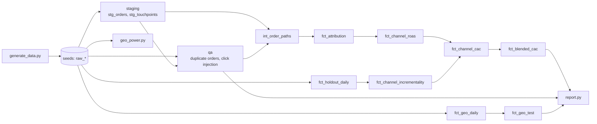

# marketing-measurement-lab

Marketing measurement as tested code: attribution models, ROAS and CAC per channel, holdout tests that show which channels add customers and which only claim them, a geo test with its power analysis, and checks that catch broken or fraudulent tracking before it reaches a budget decision.

Runs on your laptop with DuckDB: no account, no cloud, no cost. All data is synthetic and seeded: there is no real company, customer or ad account behind any number here.

**Start here**
- [Decision memo](docs/decision_memo.md): the results on one page, for the people who decide on budget.
- [Methodology](docs/methodology.md): why each method was chosen, what else was considered, and how much each choice moves the numbers.
- [Recreate it](#recreate-it): from a fresh clone to every table and chart in about five minutes.



## What it answers

**Which channel earns its budget?** Same orders, two attribution models:

| Channel | ROAS, last click | ROAS, position-based |
|---|---:|---:|
| paid_social | 1.48 | 1.83 |
| display | 1.92 | 2.35 |
| paid_search | 1.41 | 1.07 |

In this data, journeys tend to start on social and display and end on search. Last click hands search the credit for demand that other channels created. Under position-based attribution (40% first touch, 40% last, 20% shared by the middle) search drops close to break-even. The budget decision flips with the model, which is why the model choice belongs in the open, not in a dashboard default.

Orders with no tracked touchpoint (60 orders, EUR 3,621) stay in the table as `unattributed`, so the channels always add up to total revenue. Affiliate cost is the 10% commission the network invoices on the orders it claims by last click, so affiliate ROAS is exactly 10 under last click and 9.04 under position-based. A high, fixed ROAS says nothing about whether affiliates bring new customers; the next section does.

**Does the channel add customers, or claim ones who would have come anyway?** Attribution cannot tell. A holdout test can: switch the channel off in half of the regions for 28 days and measure how much *total* conversions drop. Whatever the channel claimed beyond that drop would have arrived anyway, as organic or unattributed. The generator ran one holdout per paid channel in 2025, with a planted true incrementality:

| Channel | Planted | Measured | 95% interval | Verdict |
|---|---:|---:|---:|---|
| paid_social | 0.85 | 0.92 | 0.76 to 1.08 | mostly incremental |
| display | 0.60 | 0.64 | 0.45 to 0.83 | inconclusive |
| paid_search | 0.45 | 0.38 | 0.29 to 0.48 | mostly claims existing demand |
| affiliate | 0.15 | 0.11 | -0.20 to 0.43 | mostly claims existing demand |

Incrementality 0.38 means: of every 100 customers paid search claims, about 38 would not have come without it; the other 62 would have found the shop anyway. Display's interval spans 0.5, so its test cannot call it either way.

**What does a customer really cost?** CAC per channel under three views. Incremental CAC divides cost by the customers the channel actually added (position-based customers times measured incrementality):

| Channel | CAC, last click | CAC, position-based | CAC, incremental |
|---|---:|---:|---:|
| paid_social | EUR 41.65 | EUR 33.10 | EUR 36.06 |
| display | EUR 31.55 | EUR 26.17 | EUR 41.01 |
| paid_search | EUR 42.04 | EUR 56.09 | EUR 147.21 |
| affiliate | EUR 5.92 | EUR 6.53 | EUR 58.29 |

And blended, the number finance sees, next to the views that explain it:

| View | Cost | Customers | CAC |
|---|---:|---:|---:|
| Blended: all cost / all customers | EUR 37,464 | 1,339 | EUR 27.98 |
| Paid media only (search, social, display) | EUR 36,789 | 999 | EUR 36.83 |
| Blended without affiliate, as attributed | EUR 36,789 | 1,236 | EUR 29.77 |
| Blended without affiliate, incremental | EUR 36,789 | 1,327 | EUR 27.71 |
| Incremental: paid media and affiliate cost / customers they added | EUR 37,464 | 710 | EUR 52.78 |

Affiliates look like the cheapest channel, and on paper they pull blended CAC down from EUR 29.77 to EUR 27.98. But only about 12 of their 103 customers are incremental. Without affiliates the business saves EUR 675 in commission, loses about 12 customers, and blended CAC drops to EUR 27.71. The commission mostly pays for customers who were coming anyway. The same logic makes paid search the most expensive channel per added customer, at EUR 147.

**Is the data telling the truth?** The generator plants two problems that real tracking has:

| Check | What it finds | In this data |
|---|---|---|
| `qa_duplicate_orders` | Purchase tag firing twice; a naive sum overstates revenue | 29 orders |
| `qa_click_injection` | Affiliate clicks logged seconds before checkout, claiming commission for sales they did not drive | 48 clicks, excluded from attribution |

**Did the campaign cause it?** Attribution credits touchpoints; it cannot say what would have happened without them. A geo test can. Here a campaign ran for 28 days in 6 of Germany's 16 states (Bayern, Berlin, Bremen, Mecklenburg-Vorpommern, Saarland, Sachsen); the other 10 states are the control. The generator planted a true lift of 8%.


| Readout | Estimate | 95% interval |
|---|---:|---:|
| Lift in conversions | +8.1% | +4.2% to +12.1% |
| Incremental conversions | 724 | 390 to 1,047 |
| Cost per incremental conversion (EUR 81,984 spend) | EUR 113 | EUR 78 to EUR 210 |

`fct_geo_test` runs a difference-in-differences on the daily log ratio between treatment and control, each indexed to its own 56 days before the campaign, so the shared weekend dip and trend cancel out. The interval matters as much as the estimate: the same test supports a cost per incremental conversion anywhere between EUR 78 and EUR 210.

**How big must the test be?** `scripts/geo_power.py` answers that before any money is spent. It takes only the days before the campaign, picks 500 random sets of 6 treatment regions, adds a known lift and runs the same estimator. Each simulated test uses 28 days of history, because the fake test window has to fit inside the 56 days before the campaign; the real readout uses all 56, so it is slightly more precise than this table:

| True lift | 14 days | 28 days |
|---|---:|---:|
| 0% (false alarms) | 5% | 6% |
| 4% | 34% | 53% |
| 6% | 60% | 77% |
| 8% | 82% | 93% |
| 10% | 93% | 99% |

With 6 regions, a 28-day test finds a 7% lift 80% of the time; a 14-day test needs 8%. A 4% effect would be missed about half the time, so a campaign expected to move conversions by a few percent needs more regions or more weeks, decided before the budget goes out.

## How it is checked

`dbt build` runs 16 models and 30 tests. Besides the usual `unique` / `not_null` tests, six tests guard the logic itself:

- `assert_weights_sum_to_one`: every order hands out exactly 100% credit under each model.
- `assert_revenue_reconciles`: attributed revenue equals the revenue of every order, `unattributed` included. Models move credit between channels; they never create or lose money.
- `assert_incrementality_recovers_planted`: each holdout readout's interval contains the incrementality the generator planted.
- `assert_cac_reconciles`: blended CAC rests on every customer and every euro of cost, the affiliate commission recomputed independently.
- `assert_geo_test_recovers_planted_lift`: the geo readout's interval contains the lift the generator planted.
- `assert_geo_placebo_shows_no_effect`: the same estimator on the two halves of the pre-campaign period finds nothing, so treatment and control moved together before the campaign.

A test only counts once it has been seen failing, so each one was run against a deliberately broken version:

- First-touch weight 0.45 instead of 0.4: 850 orders fail the weights test, and the reconciliation fails.
- An inner join instead of a left join in `int_order_paths` (unattributed orders dropped): the reconciliation fails.
- Removing the deduplication makes `unique_stg_orders_order_id` fail on 29 orders.
- Treating every attributed conversion as incremental (what attribution implicitly does) makes the incrementality test fail for all 4 channels.
- Dropping the affiliate commission from cost makes the CAC reconciliation fail. Its first version read the commission from the model it was checking and stayed green after this break; it now recomputes the commission itself.
- Swapping treatment and control makes the planted-lift test fail; letting the placebo read into the campaign period makes the placebo test fail.
- `geo_power.py` checks itself: with the interval removed (z = 0) its false-alarm check fails.

GitHub Actions runs the generator, the power check, the full build and the report on every push.

## Recreate it

You need Python 3.10 or newer and git. Nothing else: no database server, no cloud account.

**1. Get the code and install dbt** (one time, about a minute):

```bash
git clone https://github.com/predkiewicz/marketing-measurement-lab.git
cd marketing-measurement-lab
python -m venv .venv
source .venv/bin/activate        # Windows: .venv\Scripts\activate
pip install -r requirements.txt
```

**2. Generate the data.** Same seed, same data, so your numbers match the ones on this page:

```bash
python scripts/generate_data.py  # writes seeds/*.csv
```

**3. Build and test everything.** Loads the data into `target/lab.duckdb`, runs all models and all tests:

```bash
dbt build --profiles-dir .       # ends with: Done. PASS=... ERROR=0
```

**4. Read the results.** Prints the ROAS table, the tracking QA and the geo test readout, and redraws `docs/geo_test.svg`:

```bash
python scripts/report.py         # ROAS, CAC, incrementality, QA, geo test
python scripts/geo_power.py      # power table for the geo test
```

**5. Change a decision and see what moves.** Every setting is a dbt variable (`dbt_project.yml`):

```bash
dbt build --profiles-dir . --vars '{lookback_days: 7}'   # shorter window: search gains, social loses
python scripts/report.py
```

**6. Break a test on purpose.** In `models/marts/fct_attribution.sql`, change `then 0.4` to `then 0.45` and run `dbt build --profiles-dir .` again: `assert_weights_sum_to_one` fails. Change it back.

Different data: `python scripts/generate_data.py --users 20000 --seed 1`, then steps 3 and 4.

## Layout

```
scripts/generate_data.py   synthetic touchpoints, orders, ad spend, holdout and geo tests (stdlib only)
scripts/geo_power.py       simulation-based power for the geo test (stdlib only)
scripts/report.py          prints every result table, draws docs/geo_test.svg
docs/                      decision memo, methodology, geo test chart
models/staging/            cleaned sources, duplicates removed
models/qa/                 tracking checks: duplicate orders, click injection
models/marts/              order paths, attribution, ROAS and CAC per channel, holdout incrementality, geo test
tests/                     logic tests that must fail when the logic breaks
```

Settings live in `dbt_project.yml` vars: lookback window (30 days), click-injection threshold (10 seconds), affiliate fee (10%), incrementality verdict line (0.5), geo test start (1 June 2026) and interval (95%).

## Roadmap

- [ ] Cohort lifetime value and payback: repeat purchases and referrals, so a channel that looks weak on first-order ROAS can win on 90-day value (answers decision 2 in the memo)
- [ ] Consent-aware counts: simulate consent opt-outs that differ by device and channel, show how they distort ROAS, and how modelled conversions fill the gap
- [x] Incrementality-calibrated CAC: holdout tests per paid channel, CAC reported vs incremental
- [ ] Stronger geo inference: autocorrelated and uneven regional data, where the simple interval becomes too narrow; fix with permutation inference or time-based regression
- [ ] Agent skills that work on this repo: a Tag Manager container audit (consent settings, duplicate pixels, dead triggers), a tracking-plan writer, a metric-definition review; each with its own test cases

## Working with AI agents

The repo is set up for coding agents (Claude Code, Gemini, Codex). `AGENTS.md` holds the rules and `CLAUDE.md` imports it, so there is one source and nothing to drift. The main rule is the one above: no change is done until `dbt build` is green, and a new test is not trusted until it has been seen failing.

## Author

Piotr Prędkiewicz, marketing and product analytics, Berlin. [predkiewicz.com](https://www.predkiewicz.com) · [LinkedIn](https://www.linkedin.com/in/predkiewicz)

MIT licence.
