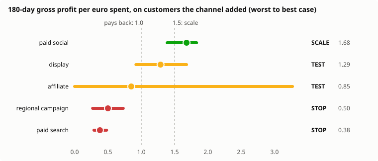
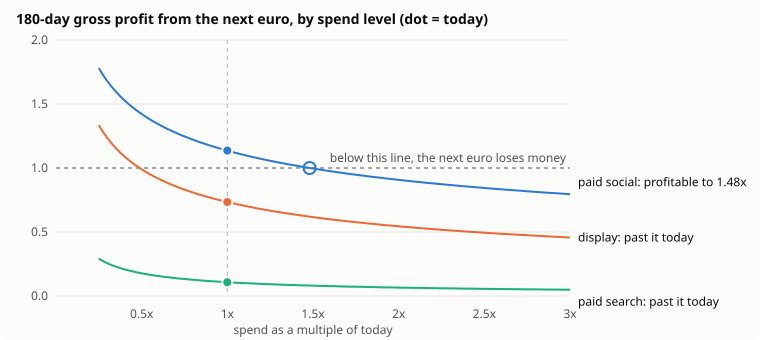

# Decision memo: marketing budget, next quarter

To: VP Marketing, CFO · From: Marketing Analytics · Data: orders January to March 2026 with 180 days of repeat purchases, channel holdout tests 2025, budget-step tests, regional campaign June 2026

*Fictional company, synthetic data. Every number comes from a fresh `dbt build` of this repo; `python scripts/report.py` prints them.*

## Our goals

- Every euro of acquisition is paid back by gross profit within 180 days.
- Blended CAC under EUR 26 (today: EUR 27.98).

## The decisions

| Channel | Decision | What we do next quarter |
|---|---|---|
| Paid social | **SCALE** | Grow to about 1.5 times today's spend, in steps, re-measuring the cost per added customer at each step |
| Display | **TEST** | Test a budget of about half of today's in some regions: its last euros do not pay back |
| Affiliate | **TEST** | Pause in half the regions for 8 weeks; withhold commission on 48 orders with injected clicks |
| Paid search | **STOP** | Switch off in its current form; keep a small budget only where a test shows it adds customers |
| Regional campaign | **STOP** | Do not repeat in this form |

With 19% less budget, these decisions bring 2% more customers and 24% more profit after marketing, and blended CAC falls to EUR 22.27, below the goal.

## How we decide

For each channel, one number: the 180-day gross profit of the customers it **added**, per euro it cost (ROI). At 1.0 the channel has paid for itself within 180 days. Every measurement has an uncertainty range, so the rule only speaks when the range allows it:

- **SCALE** when the next euro still pays back, and the average pays back even in the pessimistic case.
- **STOP** when ROI is below 1.0 even in the optimistic case.
- **TEST** otherwise: the data cannot yet back a scale or a stop.

"Customers it added" is the key part. A channel can claim many customers who would have bought anyway. We measured this by switching each channel off in half the regions for 28 days and checking how much total sales dropped.

"The next euro" is the second part. Every channel gets less efficient as it grows. We measured how much, by giving each region a different budget for 8 weeks, from zero to three times today. That gives each channel's response curve, and with it the spend at which one more euro stops paying back.

## Channel by channel

| Channel | New customers per 100 claimed | Cost per added customer | 180-day gross profit per customer | ROI: worst / expected / best | Next euro returns | Paid back |
|---|---:|---:|---:|---|---:|---:|
| Paid social | 92 | EUR 36.06 | EUR 60.55 | 1.39 / 1.68 / 1.83 | EUR 1.14 | by day 30 |
| Display | 64 | EUR 41.01 | EUR 53.08 | 0.92 / 1.29 / 1.68 | EUR 0.74 | by day 90 |
| Affiliate | 11 | EUR 58.29 | EUR 49.58 | 0.00 / 0.85 / 3.27 | not measured | no |
| Paid search | 38 | EUR 147.21 | EUR 56.09 | 0.29 / 0.38 / 0.48 | EUR 0.11 | no |
| Regional campaign | n/a | EUR 113.24 | EUR 57.02 | 0.27 / 0.50 / 0.73 | not measured | no |

**Paid social: scale, to about 1.5 times today.** Its customers are almost all new (92 of 100), they come back more than those of any other paid channel, and the money is back within a month. Even the pessimistic case pays back. Today the next euro still returns EUR 1.14; at about 1.5 times today's spend it returns EUR 1.00, and beyond that more budget would lower profit. It opens most customer journeys, which last-click reports hide: there it costs about the same per customer as search (EUR 42).

**Paid search: stop.** In last-click reports it looks fine (CAC EUR 42), because it closes journeys that other channels started. But 62 of every 100 customers it claims would have found us anyway. Per customer it actually adds, it costs EUR 147, and even in the best case only half of that comes back within 180 days. Of every EUR 1,000 spent, EUR 619 is still lost after six months.

**Affiliate: test.** It looks like our cheapest channel (CAC EUR 6) and it lowers blended CAC on paper. But only about 11 of every 100 affiliate customers are new, and they come back the least. The holdout is too uncertain to stop on: the true value lies anywhere between losing everything and the best channel we have. We also found 48 injected clicks, logged seconds before checkout to claim commission; those orders are excluded from all numbers above.

**Display: test a lower budget.** On average it pays back (ROI 1.29, by day 90), but the average hides its last euros, which return only EUR 0.74. Its response curve puts the profitable budget at about half of today's. In the pessimistic case it does not pay back at all, so we test the lower budget in some regions before cutting everywhere.

**Regional campaign: stop.** It works: conversions in the campaign regions rose by 8% (4% to 12%). But each extra customer cost EUR 113, and a customer brings EUR 57 of gross profit in 180 days. Each EUR 81,984 run returns about EUR 41,000.

## What the plan does to the goals

Stopping paid search frees EUR 14,127 and costs us only the 96 customers it actually added. Paid social takes EUR 7,137 of it, up to the point where the next euro stops paying back. The remaining EUR 6,990 is not spent: no channel we have measured would turn it into profit.

| | Current | After the decisions |
|---|---:|---:|
| Budget | EUR 37,464 | EUR 30,475 |
| Customers | 1,339 | 1,368 |
| Blended CAC | EUR 27.98 | EUR 22.27 |
| 180-day gross profit | EUR 76,353 | EUR 78,544 |
| Profit after marketing | EUR 38,889 | EUR 48,070 |
| CAC goal (under EUR 26) | missed | met |

Display's lower budget is not in these numbers yet: if its test confirms the curve, it saves more.

## How sure we are

- **Paid search and the regional campaign:** STOP holds under every assumption we tried (gross margin 40% to 60%, 90 or 180 days of customer value).
- **Paid social:** SCALE holds at our 50% gross margin and 180-day horizon, and at 60% (then up to 2.6 times today). At 40% margin, or with only 90 days of value, the next euro no longer pays back: TEST.
- **How far to scale social** is the least certain number. The budget-step test puts the profitable spend anywhere between 0.5 and 3 times today. That is why we grow in steps and re-measure at each one.
- **Display:** its last euros do not pay back under any assumption we tried.

The tracking is cleaned before any of this: 29 duplicate purchase events (2.2% of revenue overstated) are removed, and injected affiliate clicks get no credit.

**Consent.** About 40% of visitors decline tracking, and on paid social (mostly iPhone traffic) more than half. Read from consent-only tracking, paid social would show half its customers, a CAC of EUR 60 instead of EUR 33, and a TEST instead of a SCALE. These numbers use consent-modelled counts, which come within 7% of the truth for every channel, and the experiments behind them count shop orders, which consent does not affect.

## Decisions needed

| # | Decision | Recommendation | Owner |
|---|---|---|---|
| 1 | Stop paid search in its current form; grow paid social to about 1.5 times today | Yes, in monthly steps of about 15%. The plan expects social's average cost per added customer to rise from EUR 36 to about EUR 41. Stop adding budget when the next customers cost more than EUR 61, what they bring in 180 days | VP Marketing |
| 1b | The EUR 6,990 that no channel can use profitably | Keep it unspent, or fund the display and affiliate tests from it | CFO |
| 2 | Affiliate programme | Pause in half the regions for 8 weeks; withhold commission on the 48 flagged orders; renegotiate to pay only for new customers | Performance team |
| 3 | Display | Test about half of today's budget in some regions, sized in advance with the power analysis | Analytics |
| 4 | Regional campaign | Do not repeat in this form | VP Marketing |
| 5 | Reporting | Report ROI on added customers next to last-click ROAS, on consent-modelled counts, and base budget decisions on it | VP Marketing, CFO |

How these numbers were produced and why each method was chosen: [methodology.md](methodology.md).
